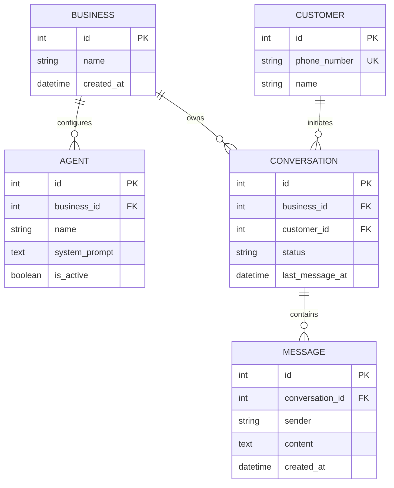
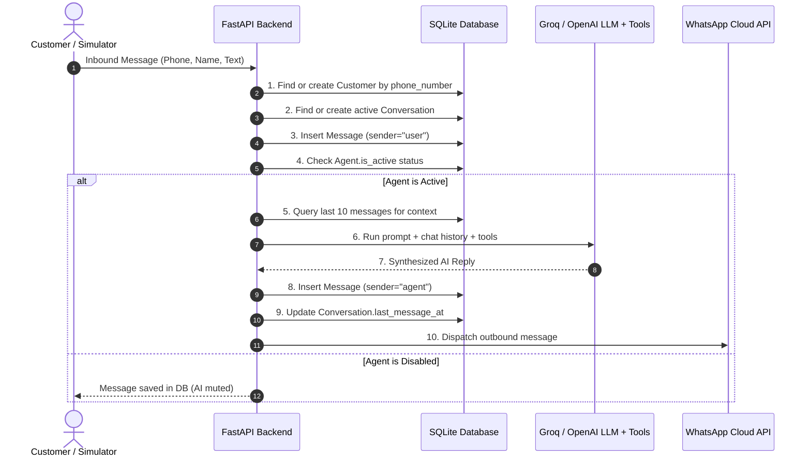

# WhatsApp AI Agent Management System

Production-ready, full-stack WhatsApp AI customer engagement and agent management platform built with **FastAPI**, **SQLAlchemy**, **SQLite**, **Groq / OpenAI LLM Function Calling**, and a **React (Tailwind CSS)** management dashboard.

---

## 🌟 Executive Overview

This system powers autonomous, context-aware WhatsApp customer interactions for online commerce and support operations. It features:

- **Bi-directional WhatsApp Cloud API integration** (Meta Graph API v21.0).
- **Dynamic LLM Engine** supporting both **Groq (`llama-3.3-70b-versatile`)** and **OpenAI (`gpt-4o-mini`)** with native function calling.
- **Business Tools**:
  1. `get_products_info(query: str)`: Searches live product inventory, pricing, availability, and specs.
  2. `check_order_status(order_id: str)`: Real-time tracking and delivery status lookup.
- **Modern React Management Dashboard**:
  - **Overview**: 4 live metric cards and active AI agent status badge.
  - **Conversations**: WhatsApp-style chat transcripts with green (customer) and grey (AI agent) bubbles.
  - **Agent & Business Settings**: Live toggle switch, persona name, system instructions, and business identity.
  - **Built-in WhatsApp Webhook Simulator**: Complete end-to-end testing widget that dispatches outbound WhatsApp replies via Meta Cloud API without requiring Meta business verification.

---

## 🏗️ Architecture & Pipeline Flow

```text
                                  +-----------------------------+
                                  |   Meta WhatsApp Cloud API   |
                                  | (GET /webhook, POST/webhook)|
                                  +--------------+--------------+
                                                 |
                                                 v
+-------------------------------+      +-------------------+
|  Built-in WhatsApp Simulator  | ---> |   FastAPI App     |
| (POST /api/simulate-whatsapp) |      | (localhost:8000)  |
+-------------------------------+      +---------+---------+
                                                 |
                   +-----------------------------+-----------------------------+
                   |                                                           |
                   v                                                           v
+--------------------------------------+             +--------------------------------------+
|       SQLite Relational DB           |             |    Groq / OpenAI LLM Engine          |
|  (Business, Agent, Customer,         | <---------> |  (llama-3.3-70b-versatile)           |
|   Conversation, Message)             |             |                                      |
+--------------------------------------+             |  Tools:                              |
                                                     |  - get_products_info(query)          |
                   ^                                 |  - check_order_status(order_id)      |
                   |                                 +--------------------------------------+
                   v                                                 |
+--------------------------------------+                             | (Outbound WhatsApp Msg)
|   React Management Dashboard         |                             v
|  (Vite + Tailwind CSS on :3000)      |             +--------------------------------------+
|  - Overview Analytics                |             |    Meta Graph API v21.0 Dispatch     |
|  - WhatsApp Chat Transcripts         |             +--------------------------------------+
|  - Agent Config & Toggle Switch      |
+--------------------------------------+
```

---

## 🗄️ Database Structure & Data Lifecycle

The relational schema is configured in `backend/models.py` using **SQLAlchemy** and **SQLite** (easily migratable to PostgreSQL via `DATABASE_URL`).

### 1. Entity-Relationship (ER) Diagram



### 2. Table Specifications

| Model | Primary Key | Foreign Keys | Key Attributes & Descriptions |
| --- | --- | --- | --- |
| **`businesses`** | `id` (int) | — | `name` (string), `created_at` (datetime). Represents the store identity. |
| **`agents`** | `id` (int) | `business_id` → `businesses.id` | `name` (string), `system_prompt` (text), `is_active` (boolean toggle). Controls AI persona and behavior. |
| **`customers`** | `id` (int) | — | `phone_number` (string, indexed, unique), `name` (optional string). |
| **`conversations`** | `id` (int) | `business_id`, `customer_id` | `status` (active/closed), `last_message_at` (datetime). Groups messages per customer. |
| **`messages`** | `id` (int) | `conversation_id` → `conversations.id` | `sender` ("user" or "agent"), `content` (text), `created_at` (datetime). |

### 3. Pipeline Data Lifecycle

When a message is received (via live WhatsApp Webhook or the Dashboard Simulator), the backend orchestrates the following flow:



---

## ⚙️ Environment Variables Configuration (`backend/.env`)

The project supports both OpenAI and Groq seamlessly. When an API key starting with `gsk_` is detected, the backend automatically connects to `https://api.groq.com/openai/v1` and uses `llama-3.3-70b-versatile` for blazing-fast function calling.

```ini
# Database Configuration
DATABASE_URL=sqlite:///./whatsapp_system.db

# LLM Configuration (Groq or OpenAI)
# If OPENAI_API_KEY begins with 'gsk_', Groq is automatically initialized
OPENAI_API_KEY=gsk_your_groq_api_key_or_sk_openai_key
OPENAI_MODEL=llama-3.3-70b-versatile

# Meta WhatsApp Cloud API Credentials
WHATSAPP_TOKEN=EAAZ...
WHATSAPP_PHONE_NUMBER_ID=1527102377143902
WHATSAPP_VERIFY_TOKEN=my_secure_verify_token
```

---

## 🚀 Step-by-Step Setup Instructions

### 1. Backend Setup (FastAPI)

1. Open a terminal in the `backend/` directory:

```bash
cd backend
```

2. Create and activate a Python virtual environment:

```bash
# Windows (PowerShell):
python -m venv venv
.\venv\Scripts\Activate.ps1

# Linux / macOS:
python3 -m venv venv
source venv/bin/activate
```

3. Install dependencies:

```bash
pip install -r requirements.txt
```

4. Start the backend server:

```bash
uvicorn main:app --reload --port 8000
```

- API Base URL: `http://localhost:8000`
- Interactive Swagger API Documentation: `http://localhost:8000/docs`

---

### 2. Frontend Setup (React + Tailwind CSS)

1. Open a second terminal in the `frontend/` directory:

```bash
cd frontend
```

2. Install npm packages:

```bash
npm install
```

3. Start the Vite development server:

```bash
npm run dev
```

4. Access the dashboard in your browser:

- `http://localhost:3000` (or `http://localhost:5173`)

---

## 🧪 Evaluator & Interview Testing Guide

Meta's Developer Portal currently blocks direct mobile-to-webhook delivery in Unpublished/Dev apps unless the recipient is explicitly registered in the Meta App Test Numbers list and Business Verification is finalized.

To provide a 100% reliable, zero-friction review experience, the project provides **two testing methods**:

### Method 1: The Built-in WhatsApp Webhook Simulator (Recommended)

1. In the React Dashboard, click the **"WhatsApp Simulator"** button (located in the top bar of Overview, in the left navigation sidebar, and in Conversations).

2. The simulator modal opens with:

   - **Customer Phone Number**: pre-filled with `+923090139836` (or any custom number).
   - **Customer Name**: pre-filled with `Rubaisha`.

3. Click any of the **1-Click Test Scenarios**:

   - 🛍️ *"What products do you have in stock and their prices?"* → Triggers `get_products_info` and returns the catalog with prices.
   - 📦 *"Check status of my order #9999"* → Triggers `check_order_status` for order 9999 (Rubaisha, Shipped via DHL).
   - 🚚 *"Where is my order ORD-9988?"* → Triggers `check_order_status` for ORD-9988 (Processing).

4. Click **"Send Message"**:

   - The message is processed through the complete backend pipeline (`process_incoming_message`).
   - Saved to SQLite DB.
   - LLM executes the required tools.
   - Real outbound message is dispatched via Meta Cloud API (`send_whatsapp_message`).
   - The dashboard updates in real time: conversation list, messages count, and WhatsApp chat history view.

---

### Method 2: Meta Cloud API Webhook

1. If deploying to the web or exposing via ngrok:

```bash
ngrok http 8000
```

2. In Meta App Dashboard → **WhatsApp** → **Configuration**:

   - **Callback URL**: `https://<your-ngrok-domain>/webhook`
   - **Verify Token**: `my_secure_verify_token` (matches `WHATSAPP_VERIFY_TOKEN`)
   - **Webhook Fields**: Subscribe to `messages`.

3. Send a test message or a live WhatsApp message; the webhook will parse `hub.mode`, verify token, and handle `POST /webhook` asynchronously.

---

## 🛠️ Integrated LLM Tools & Mock Data

### 1. `get_products_info(query: str)`

- Searches product catalog items:
- **Wireless Noise-Canceling Headphones**: $149.99 (In Stock: 42 units)
- **Smart Fitness Watch Ultra**: $199.99 (In Stock: 18 units)
- **Pro Mechanical Gaming Keyboard**: $89.99 (In Stock: 27 units)
- **Ergonomic Aluminum Laptop Stand**: $39.99 (In Stock: 65 units)
- **7-in-1 Dual HDMI USB-C Hub**: $49.99 (Out of Stock / 0 units)

### 2. `check_order_status(order_id: str)`

- **Order #9999**: Customer Rubaisha, Status: *Shipped*, Carrier: DHL Express (Tracking: `DHL-PK-8829103`).
- **Order #12345**: Customer John Doe, Status: *Delivered* yesterday via FedEx.
- **Order #ORD-9988**: Customer Sarah Connor, Status: *Processing* (expected dispatch tomorrow).
- **Any other order ID**: Fallback deterministic status calculation so every order ID tested returns a valid status.

---

## 📋 API Reference Summary

| Method | Endpoint | Description |
| --- | --- | --- |
| `GET` | `/webhook` | Meta Cloud API webhook verification (`hub.verify_token`, `hub.challenge`). |
| `POST` | `/webhook` | Inbound WhatsApp webhook message handler (delegates to background task). |
| `POST` | `/api/simulate-whatsapp` | Dedicated simulator endpoint running full pipeline + Meta Cloud API dispatch. |
| `GET` | `/api/stats` | Aggregated metrics: total conversations, customers, messages, active agent status. |
| `GET` | `/api/conversations` | List of all conversations with phone numbers and last message time. |
| `GET` | `/api/conversations/{id}` | Chronological chat history for a specific conversation. |
| `GET` | `/api/agent` | Get current AI agent settings and business name. |
| `PUT` | `/api/agent` | Update AI agent name, system prompt, active toggle, and business name. |